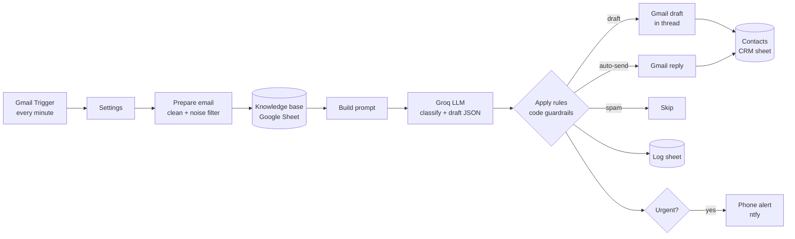

# ReplyFlow — AI Email & Customer Inquiry Automation

**An n8n + AI workflow that reads a business's customer emails, sorts them, drafts on-brand replies from the business's own knowledge base, and puts them in Gmail for one-click approval — while keeping a CRM up to date and alerting staff about urgent emails on their phone.**

Built for e-commerce stores, agencies and consulting firms that lose hours every day answering the same customer emails by hand.

<!--
Add screenshots to docs/screenshots/ and uncomment:


-->

---

## What it does

| Step | What happens |
|---|---|
| **Read** | Checks the Gmail inbox every minute for new, unread customer emails. |
| **Filter** | Drops newsletters, notifications, promotions, bounces and auto-replies before they cost an AI call. |
| **Classify** | The AI sorts each email into **Sales, Support, Complaint, Spam or Other**, and scores urgency, sentiment and confidence. |
| **Draft** | Writes a personalised reply using **only** facts from the business's knowledge base (a Google Sheet). Missing facts become `[PLACEHOLDERS]` instead of made-up answers. |
| **Approve** | The reply lands as a **Gmail draft inside the customer's thread**, so staff review it and click Send. Optional auto-send is available for safe, high-confidence emails. |
| **CRM** | Saves or updates the customer in a Contacts sheet (name, company, last order, last contact). |
| **Log** | Records every email (category, urgency, confidence, action, AI summary) for reporting. |
| **Alert** | Urgent emails, such as angry customers, payment problems, late orders or legal threats, trigger an instant phone notification that opens the Gmail thread. |

## How it works



## Safety by design

AI writes the drafts, but **code decides what is allowed to happen**:

- **Human approval by default.** Every reply is a draft until a person sends it.
- **Auto-send is opt-in and fenced.** It only fires for chosen categories above a confidence threshold. It is **always blocked** for refunds, discounts, legal or chargeback language, angry customers, urgent emails, low confidence, or drafts that still contain `[placeholders]`.
- **No made-up facts.** The model may only use the knowledge base. Gaps are surfaced, not invented.
- **Prompt-injection guard.** Email content is treated as untrusted data, and the routing guardrails run after the AI, so a malicious email can't talk its way into being auto-sent.
- **Fails safe.** If the AI call fails or times out, the email still gets a "reply manually" draft, a log entry, and an alert if it looks urgent. Nothing is silently dropped.

## Tech stack

- **n8n** (workflow automation, self-hosted or n8n Cloud)
- **Groq** LLM API (OpenAI-compatible, JSON output), model configurable
- **Gmail API** (trigger, threaded drafts, replies)
- **Google Sheets** as the knowledge base, CRM and log
- **ntfy** push notifications (swappable for Slack, email or the WhatsApp Business API)
- **JavaScript** Code nodes, with a Node.js test harness that runs them outside n8n

## Project structure

```
replyflow/
├── dist/
│   ├── replyflow-email-automation.json   # import into n8n
│   └── replyflow-sheet-template.xlsx     # Knowledge / Contacts / Log template
├── src/                                  # source of the workflow's Code nodes
│   ├── settings.js                       # per-client configuration
│   ├── prepare.js                        # email cleaning + noise filter
│   ├── attachKnowledge.js                # knowledge base + LLM prompt
│   └── applyRules.js                     # JSON parsing, guardrails, routing
├── build.js                              # builds the n8n workflow JSON from src/
├── test.js                               # runs the Code nodes against sample emails
├── scripts/make_sheet.py                 # generates the Sheet template
└── docs/SETUP.md                         # full step-by-step setup guide
```

## Quick start

```bash
npm test          # run the logic tests (no n8n needed)
npm run build     # rebuild dist/replyflow-email-automation.json after editing src/
```

Then follow **[docs/SETUP.md](docs/SETUP.md)**: import the workflow into n8n, connect Gmail, Google Sheets and Groq, set up phone alerts, and send the test emails.

## Tested scenarios

`test.js` runs the real Code-node logic against 8 sample emails with a mocked n8n runtime:

| Email | Result |
|---|---|
| Late order + refund request | Complaint · **urgent** · draft (refund guardrail) · alert |
| Bulk pricing question | Sales · draft with `[BULK PRICE]` placeholder |
| Delivery-time question | Support · auto-sent **only** when auto-send is enabled |
| SEO pitch with a prompt-injection attempt | Spam · skipped |
| Charged twice, and the AI API fails | Urgent · safe "reply manually" draft |
| Newsletter, no-reply notification, promotion | Filtered out before the AI |

## Roadmap

- Shopify / WooCommerce order lookup, so replies include live order status
- HubSpot CRM option
- Outlook / Microsoft 365 support
- WhatsApp Business alerts
- Web dashboard: approval inbox, analytics, knowledge-base editor

## Work with me

I set this up for businesses: connected to your inbox, trained on your policies and FAQs, with your alert channel of choice.

**Ali Raza** · [GitHub](https://github.com/AliRaza171-cloud) · Fiverr: *[add your gig link]*
